<p align="center">
  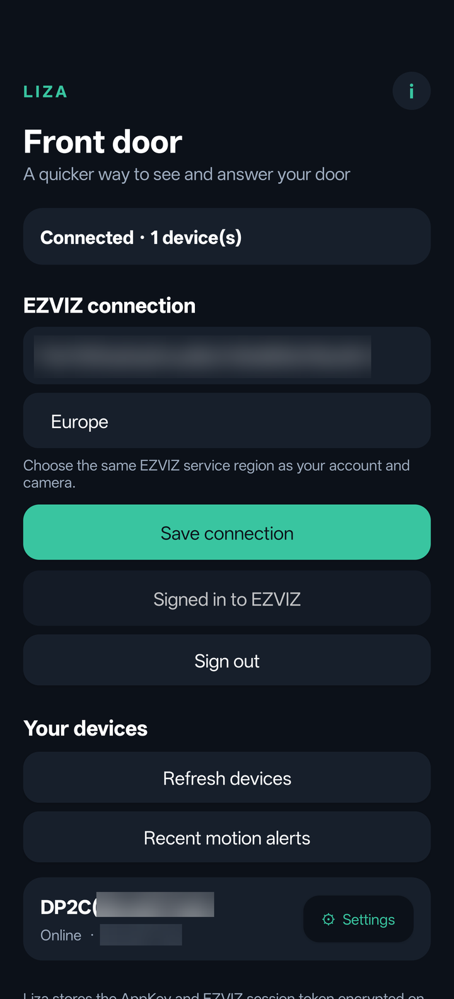
  &nbsp;
  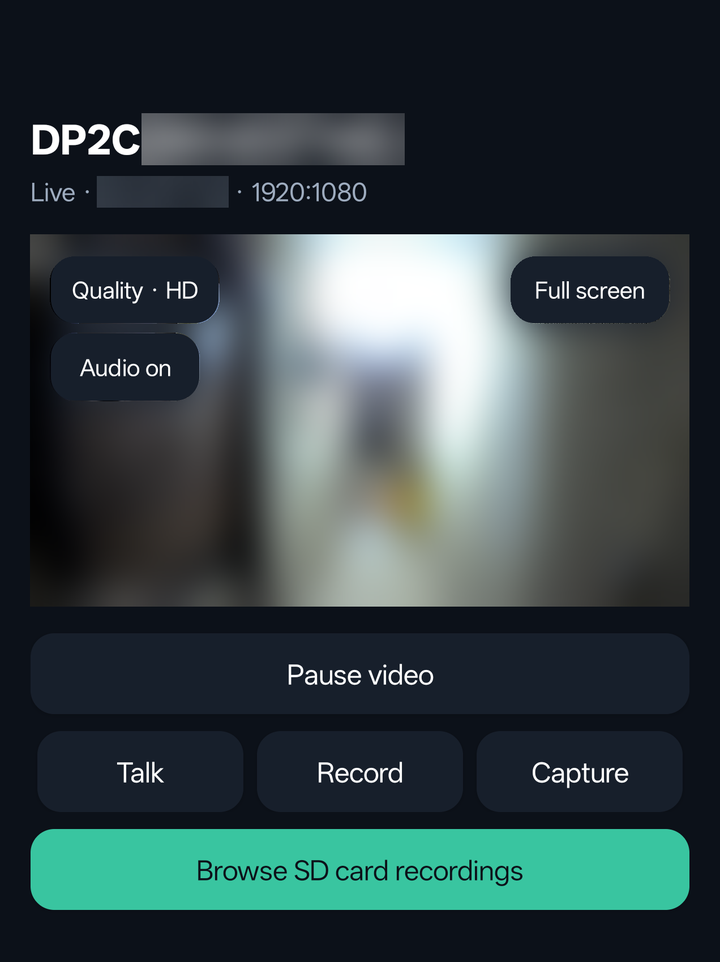
  &nbsp;
  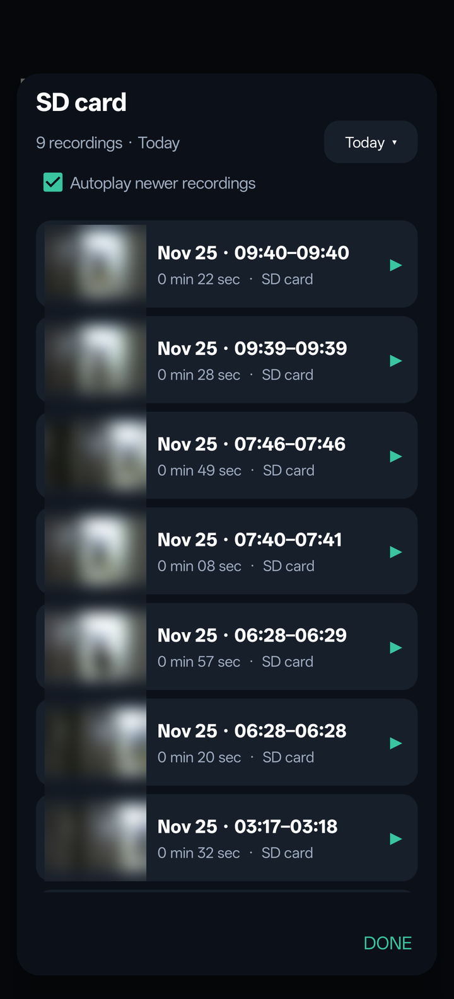
  &nbsp;
  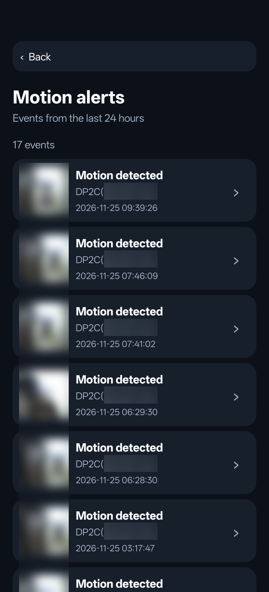
</p>

# Liza

**A quicker way to see and answer your door.**

Liza is a lightweight native Android app for fast access to EZVIZ cameras. It was built for the **EZVIZ DP2C smart door viewer** on the official [EZVIZ Open Platform Android SDK](https://github.com/Ezviz-Open/EzvizSDK-Android) 5.33.1. It opens straight to your camera, without the menus of the full EZVIZ app.

> Liza is an independent project and is not affiliated with or endorsed by EZVIZ.

## Features

- **Live video** with Fluent / Balanced / HD quality, mute toggle, pinch-to-zoom (up to 4×) and landscape full screen
- **Two-way talk** while the live video keeps playing
- **Snapshots and recording** saved to your gallery (`Pictures/Liza`, `Movies/Liza`)
- **SD card recordings**: browse by date, auto-generated thumbnails, seek, ±10 s, and autoplay of newer clips
- **Motion alerts** from the last 24 hours, with snapshots; tap one to play the matching SD recording
- **Device settings**: rename, arm/disarm, storage status, video quality, and 180° image flip
- **SD card reminder**: Liza detects when the card is full and overwriting, learns how many days a full card lasts, and notifies you before the next one fills
- **Encrypted streams**: asks for the camera's verification code once and remembers it
- **Automatic fallback** from EZVIZ relay to direct P2P when video doesn't arrive
- **Private by design**: the AppKey, token and codes are encrypted with Android Keystore; Liza never sees your EZVIZ password and has no analytics

## Screenshots

| Setup | Live view | Full screen |
|---|---|---|
| 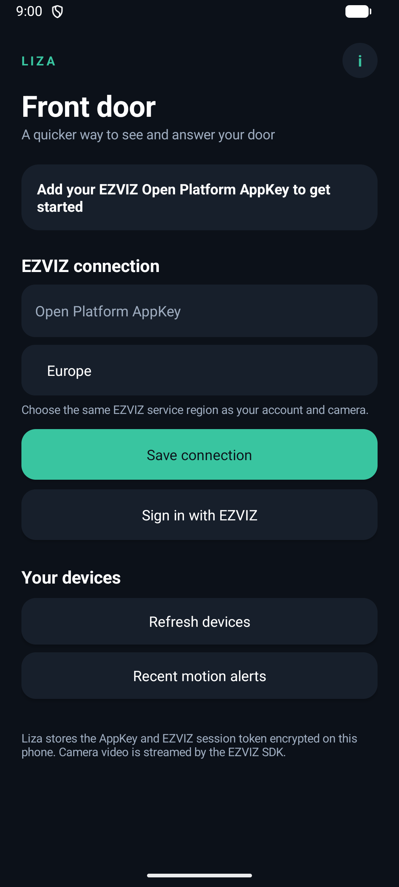 | 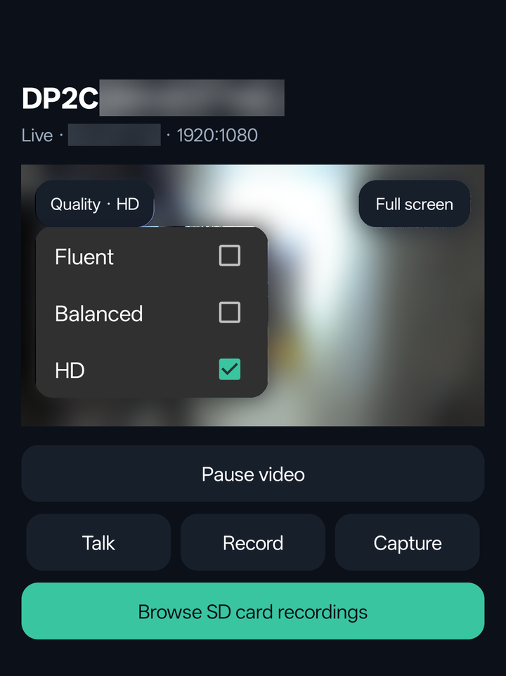 | 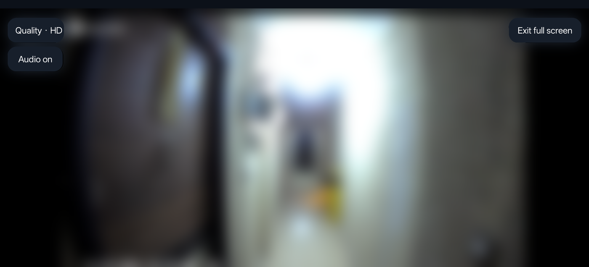 |
| **SD playback** | **Device settings** | **About** |
| 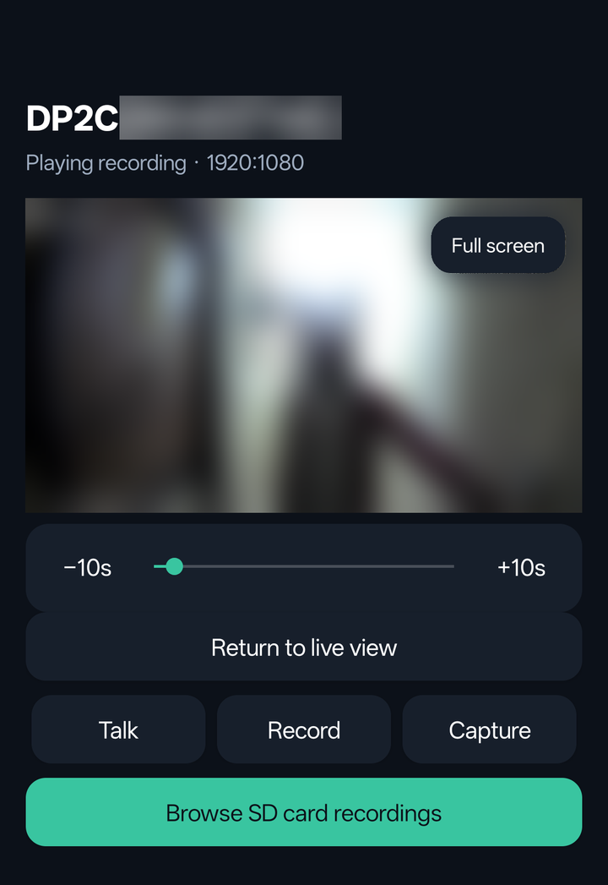 | 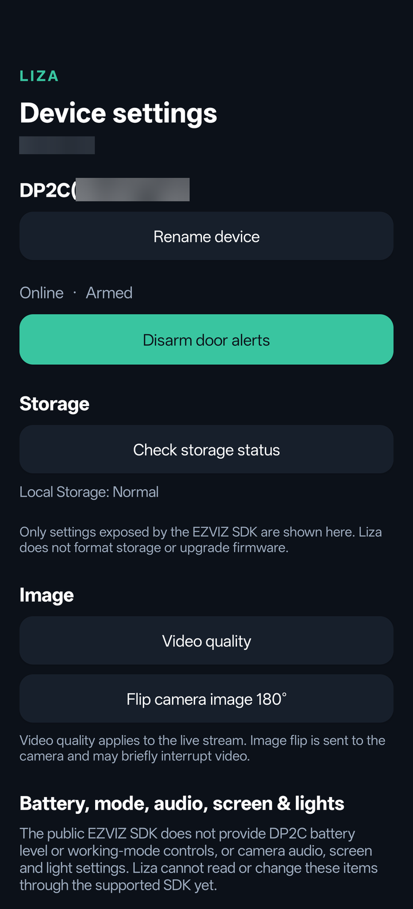 | 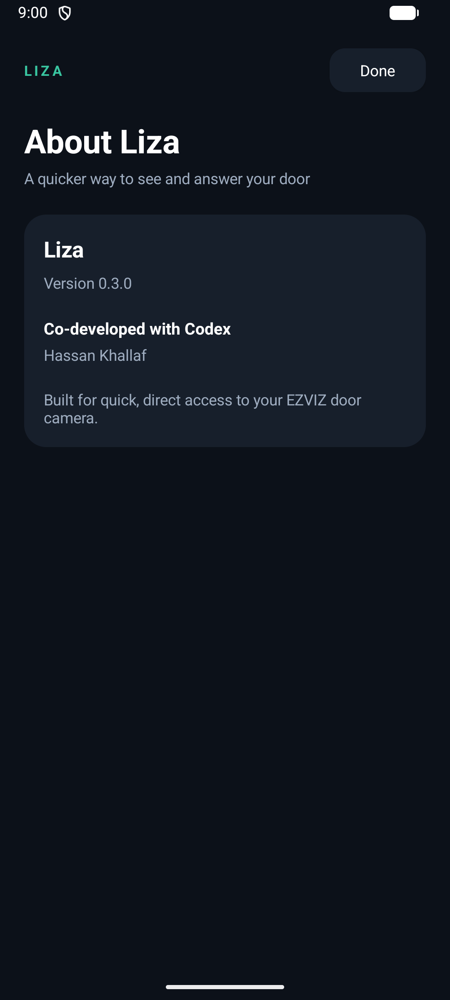 |

Camera video, thumbnails, the AppKey and device serial numbers are blurred for privacy.

## Liza web (for your computer)

The [`web/`](web/) folder has a computer version of Liza. It runs locally at `http://localhost:8790` with a small Python server and EZVIZ's official web player. It offers live video in SD/HD/FHD, zoom, full screen, two-way talk, snapshots, MP4 recording, SD card playback with thumbnails, motion alerts, device settings and the SD card reminder.

<p align="center">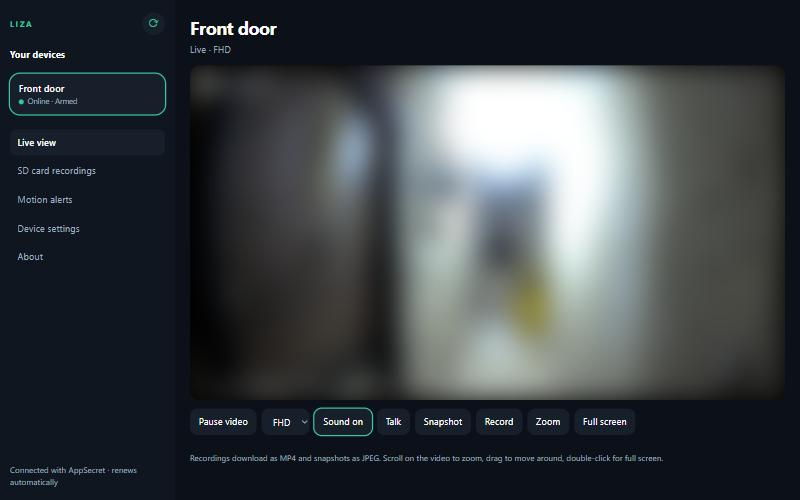</p>

```bash
cd web
python get_player.py   # one time: downloads EZVIZ's web player
python server.py       # open http://localhost:8790
```

On Windows, double-click `web/Start Liza.bat`. See the [Liza web README](web/README.md) for setup, the AppSecret option and privacy details.

## Download

| Version | Download |
|---|---|
| **Android** | [Liza 0.4.0](https://github.com/titaniumgui/Liza/releases/tag/v0.4.0): `Liza-0.4.0.apk`. See the [user guide](docs/USER_GUIDE.md#install-the-apk) for install steps. |
| **Computer (web)** | [Liza web 1.1.0](https://github.com/titaniumgui/Liza/releases/tag/web-v1.1.0): `Liza-web-1.1.0.zip`. See the [Liza web README](web/README.md). |

All versions are on the [**Releases**](../../releases) page.

Requirements for Android: an ARM phone running Android 6.0 or newer, an EZVIZ account, and your own [EZVIZ Open Platform](https://open.ezviz.com) **AppKey**.

## Quick start

1. Install the APK and open **Liza**.
2. Paste your **Open Platform AppKey** and choose your account's **region**, then tap **Save connection**.
3. Tap **Sign in with EZVIZ** and sign in on EZVIZ's page.
4. Tap your camera to open live view. If video is encrypted, enter the code from the camera's label.

## Documentation

| Document | What's inside |
|---|---|
| [User guide](docs/USER_GUIDE.md) | Setup, every screen and button, file locations, troubleshooting |
| [Liza web](web/README.md) | The computer version: setup, AppSecret vs sign-in, privacy, workarounds |
| [Architecture](docs/ARCHITECTURE.md) | Code structure, components, flows, data storage, SDK calls used |
| [Building](docs/BUILDING.md) | Toolchain, build and install commands, release signing notes |
| [Security & privacy](docs/SECURITY_PRIVACY.md) | What is stored and how, permissions, network behaviour |
| [Known issues](docs/KNOWN_ISSUES.md) | Bugs, limitations and housekeeping items |

## Build from source

```powershell
.\gradlew.bat assembleDebug
```

You need JDK 17–21 (with `JAVA_HOME` set) and Android SDK Platform 35. The output is `app/build/outputs/apk/debug/app-debug.apk`. See [Building](docs/BUILDING.md) for details, including signed release builds.

## Project status

Version **0.4.0**. Live view, talk, recording, SD playback, alerts, device settings and the SD card reminder are implemented. Push notifications for alerts are **not** implemented. A computer version, [Liza web](web/README.md), is included and tested with a DP2C. See [Known issues](docs/KNOWN_ISSUES.md).

## License

Liza is free software, licensed under the [GNU General Public License v3.0](LICENSE). The EZVIZ SDK it depends on is distributed by EZVIZ under its own terms.

## Credits

Developed by Hassan Khallaf, co-developed with Codex.

## References

- [EZVIZ SDK download center](https://icnopen.ezviz.com/cn/s/download)
- [Official Android SDK sample](https://github.com/Ezviz-Open/EzvizSDK-Android)
- [EZVIZ Android SDK guide](https://support.ezviz.com/faq/428)
- [DP2C specifications](https://www.ezviz.com/product/dp2c/38395)
