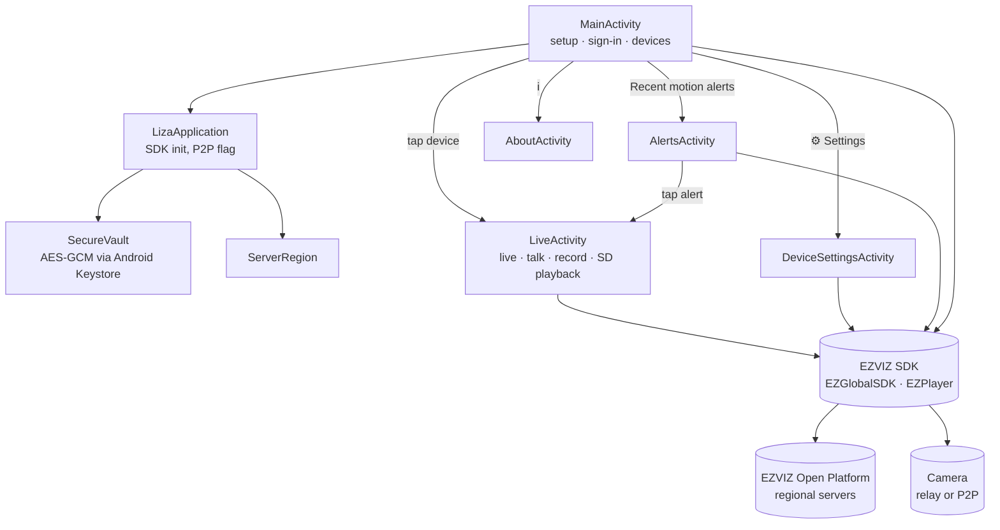
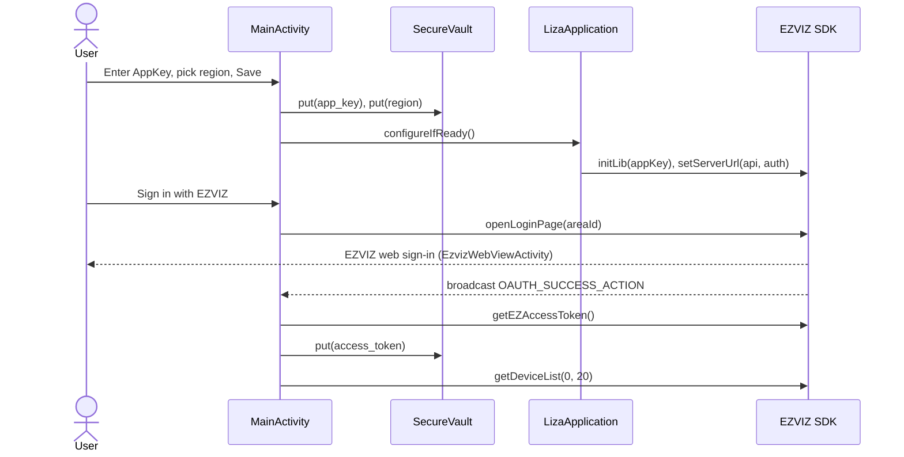
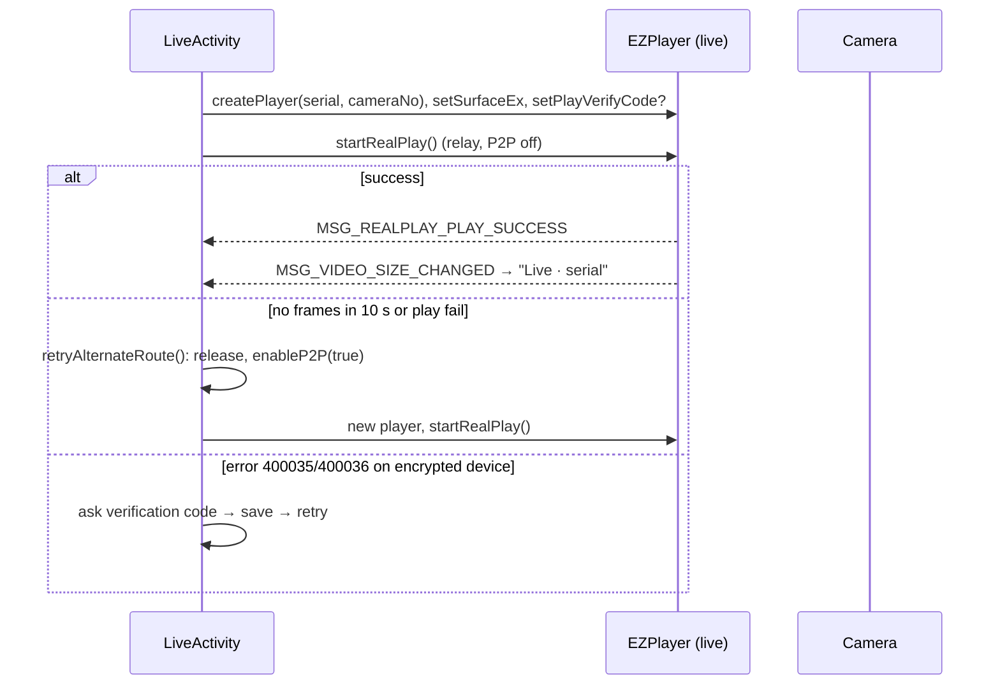

# Liza architecture

Liza is a small, single-module Android app written in plain Java. It has no AndroidX and no XML layouts: every screen builds its views in code. All camera work goes through the official **EZVIZ Open Platform Android SDK** (`io.github.ezviz-open:ezviz-sdk:5.33.1`).

- [Project layout](#project-layout)
- [Build configuration](#build-configuration)
- [Components](#components)
- [Key flows](#key-flows)
- [Data storage](#data-storage)
- [Threading model](#threading-model)
- [EZVIZ SDK surface used](#ezviz-sdk-surface-used)
- [UI conventions](#ui-conventions)

---

## Project layout

```
Liza/
├── build.gradle                 Root: Android Gradle Plugin 8.7.3
├── settings.gradle              Repositories (Google, Maven Central); includes :app
├── gradle.properties            AndroidX flags
├── gradle/wrapper/              Gradle 8.11.1 wrapper
├── gradlew.bat                  Windows wrapper script
├── app/
│   ├── build.gradle             App module config and dependencies
│   └── src/main/
│       ├── AndroidManifest.xml
│       ├── java/app/liza/android/
│       │   ├── LizaApplication.java          SDK init and app-wide state
│       │   ├── SecureVault.java              Keystore-backed encrypted preferences
│       │   ├── ServerRegion.java             EZVIZ region → server URLs
│       │   ├── MainActivity.java             Home: setup, sign-in, device list
│       │   ├── LiveActivity.java             Live view, talk, record, SD playback
│       │   ├── AlertsActivity.java           Last-24-hours alarm list
│       │   ├── DeviceSettingsActivity.java   Rename, arm/disarm, storage, SD reminder, image
│       │   ├── SdReminder.java               SD reminder storage, alarm and notification
│       │   ├── AboutActivity.java            Version, credits, language
│       │   ├── LanguageActivity.java         First-run language choice
│       │   ├── I18n.java                     tr(), locale and RTL for every screen
│       │   └── AlarmNotificationJobService.java  Empty placeholder
│       └── res/
│           ├── drawable/ic_liza*.xml         Vector "LIZA" logo
│           ├── mipmap*/ic_launcher.xml       Adaptive launcher icon
│           ├── raw/ar.json                   Arabic translations, keyed by English text
│           └── values/colors.xml, styles.xml Dark Material theme
├── tools/check_i18n.py          Finds untranslated strings (both editions)
└── docs/                        This documentation
```

Source size: about 2,900 lines of Java, more than half of it in `LiveActivity`.

## Build configuration

| Setting | Value |
|---|---|
| `applicationId` / `namespace` | `app.liza.android` |
| `versionName` / `versionCode` | `0.5.0` / `5` |
| `compileSdk` / `targetSdk` | 35 |
| `minSdk` | 23 (Android 6.0, required by the Keystore AES key in `SecureVault`) |
| Java | Source and target 17 |
| ABIs | `armeabi-v7a`, `arm64-v8a` |
| Build types | `debug`, and `release` signed from a keystore outside the repository (see [Building](BUILDING.md#release-builds)). No code shrinking: the EZVIZ SDK uses reflection and JNI |

Dependencies:

| Library | Version | Purpose |
|---|---|---|
| `io.github.ezviz-open:ezviz-sdk` | 5.33.1 | EZVIZ auth, device API, video player, talk |
| `com.squareup.okhttp3:okhttp` | 3.12.1 | Required by the EZVIZ SDK |
| `com.google.code.gson:gson` | 2.8.5 | Required by the EZVIZ SDK |

The native libraries in the EZVIZ SDK are why the APK is about 48–51 MB.

## Components



### `LizaApplication`
Owns the single `SecureVault` and initialises the SDK lazily through `configureIfReady()`:

1. Reads `app_key` from the vault. With no key, it returns `false` and the UI asks for one.
2. On first call, turns off SDK logging, **disables P2P** (relay first), and calls `EZGlobalSDK.initLib(app, appKey)`.
3. Applies the region's API and auth URLs with `setServerUrl` whenever the region changes.
4. Restores the stored `access_token` into the SDK.

It also holds the app-wide P2P flag (`isP2pEnabled` / `setP2pEnabled`) that `LiveActivity` flips when it falls back to a direct connection.

### `SecureVault`
A small key-value store on top of `SharedPreferences("liza_secure")`. Each value is encrypted with **AES-256-GCM** using a non-exportable key (`liza.openplatform.credentials.v1`) in the **Android Keystore**. The stored format is Base64 of `[ivLength][iv][ciphertext+tag]`. If decryption fails (for example after a Keystore reset), the entry is deleted and `null` is returned, which the UI treats as "not set".

### `ServerRegion`
An enum of the five EZVIZ regions. Each has a label, an `areaId` for the sign-in page, and its API and auth base URLs. Unknown labels fall back to `EUROPE`.

### `MainActivity` — home
- Saves the AppKey and region. If either changed, it clears the token.
- Opens EZVIZ OAuth with `openLoginPage(areaId)` and listens for the SDK broadcast `com.videogo.action.OAUTH_SUCCESS_ACTION`. The receiver is registered as not exported on Android 13+.
- Loads devices with `getDeviceList(0, 20)` and builds one card per device.
- Passes `serial`, `name`, `cameraNo` (first camera), `videoLevel` and `encrypted` to `LiveActivity` as intent extras.

### `LiveActivity` — the core screen
Uses a `TextureView` and up to **three `EZPlayer` instances** at once:

| Player | Role |
|---|---|
| `livePlayer` | Real-time stream; also used for recording and snapshots |
| `playbackPlayer` | SD card playback and thumbnail scanning |
| `talkPlayer` | Audio-only player for two-way talk, so live video keeps running |

Player events arrive on a main-thread `Handler` (`handlePlayerMessage`): play success or failure, video size changes, and talk start, fail and stop.

Main features:
- **Relay → P2P fallback**: a 10-second first-frame timeout, or a stream failure, triggers `retryAlternateRoute()`. It releases the player, enables P2P, and restarts once per screen visit.
- **Encrypted streams**: errors `400035` and `400036` open a verification-code prompt. The code is stored as `verify_<serial>` in the vault and applied to every new player.
- **Zoom and pan**: a `ScaleGestureDetector` plus two-finger pan. They map to `EZPlayer.setDisplayRegion()` on the source resolution, so the camera image is cropped rather than the view scaled.
- **Aspect ratio**: parsed from the SDK's video-size message; the surface is letterboxed to fit.
- **Full screen**: forces landscape, hides system bars (immersive sticky), hides everything except the video, and moves playback controls on top of the video.
- **Recording and snapshots**: written to the app's external files folder first. `publishMediaFile()` then copies them into MediaStore (`Pictures/Liza`, `Movies/Liza`) on Android 10+, or the public folders plus a media scan on older versions. For MP4s it waits until the file size is stable, because the SDK finishes writing asynchronously.
- **SD card browsing**: `searchRecordFileFromDevice` for a chosen day, with a 30-second timeout dialog. Results are sorted newest first and shown in a custom dialog with a date picker and an autoplay toggle.
- **Thumbnail scan**: plays each uncached clip briefly on `playbackPlayer`, captures a frame after the first video-size event, scales it to 240×135 JPEG, and caches it in `cacheDir/record-thumbnails/`.
- **Alert playback**: when started from an alert, it searches from the alert time minus the pre-record time (at least 60 s) to 3 minutes after. It plays the closest clip and seeks to the event.
- **Lifecycle**: `onStop` stops and releases all players; `onStart` restarts live view when the surface is ready.

### `AlertsActivity`
Calls `getAlarmList(null, 0, 50, now-24h, now)` for all devices. Snapshots load with plain `URLConnection` on a 4-thread pool. Tapping a card opens `LiveActivity` with `alarmTime`, `alarmPreTime` and `alarmId` extras.

### `DeviceSettingsActivity`
Thin wrappers around SDK calls: `getDeviceInfo`, `setDeviceName`, `setDefence` (IPC open or close), `getStorageStatus`, `setVideoLevel` and `controlVideoFlip`. Each runs on a single worker thread and reports into a status line.

### `SdReminder` and the SD card reminder
EZVIZ reports SD capacity (`GET /api/v3/device/format/status`, called with OkHttp because the SDK's `EZStorageStatus` has no size) but not free space, and SD clips have no file size. Clip length × bitrate was tried and was about 10× too optimistic on a DP2C, so it isn't used. Instead `DeviceSettingsActivity` finds the oldest recording on the card (`searchRecordFileFromDevice`, one day per probe: weekly steps back, then day by day). If it is newer than the day the card was emptied, the card is full and overwriting, and today minus that day is how many days a full card holds. That "life" is saved and drives later check dates (90% of it). `SdReminder` stores the plan, schedules an inexact `AlarmManager` alarm for 9:00 on the check date, posts the notification (`AlarmReceiver`) and reschedules after a reboot (`BootReceiver`). Liza web implements the same logic in `app.js`.

### `I18n` and `LanguageActivity` — languages
UI text stays in English in the code and goes through `tr("English text", args…)`, which looks it up in `res/raw/ar.json` (with `{0}`, `{1}` placeholders). Every activity overrides `attachBaseContext()` with `I18n.wrap()`, which applies the chosen locale and its layout direction. The manifest sets `supportsRtl`, so Arabic screens mirror. Text views align to the layout's start edge, so Latin-only text sits on the right in Arabic. The video surface and its overlay buttons are not mirrored. Arabic uses `ar-u-nu-latn`, which keeps Western digits. `MainActivity` opens `LanguageActivity` until a language is saved (`liza_settings`/`language`). About can change it, which restarts the task. Run `python tools/check_i18n.py` after changing UI text: it lists missing or unused translations and mismatched placeholders for both editions.

### `AboutActivity`
Static screen showing `versionName` from the package manager and credits.

### `AlarmNotificationJobService`
Contains only a `package` line. It isn't declared in the manifest and does nothing. See [Known issues](KNOWN_ISSUES.md#no-push-notifications).

## Key flows

### Setup and sign-in



### Starting live view



## Data storage

| Store | Keys / path | Encrypted | Contents |
|---|---|---|---|
| `SharedPreferences("liza_secure")` | `app_key`, `region`, `access_token`, `verify_<serial>` | Yes (AES-GCM, Keystore) | Credentials and per-camera verification codes |
| `SharedPreferences("liza_settings")` | `quality_<serial>`, `sd_autoplay_next`, `language` | No | UI preferences and the app language |
| `SharedPreferences("liza_sd")` | `start_`, `check_`, `full_`, `life_`, `name_`, `notified_<serial>` | No | SD card reminder plan |
| `cacheDir/record-thumbnails/*.jpg` | Hash of `serial_start_stop` | No | SD clip thumbnails |
| `getExternalFilesDir(Pictures|Movies)/Liza/` | `Liza-<ms>.jpg/.mp4` | No | Staging copies before publishing |
| MediaStore `Pictures/Liza`, `Movies/Liza` | `Liza-<ms>.jpg/.mp4` | No | User-visible snapshots and recordings |

`android:allowBackup="false"` keeps all app data out of Android cloud backups.

## Threading model

- Every SDK network call runs on an `ExecutorService`: one single-thread executor per activity, except `AlertsActivity`, which uses a 4-thread pool so snapshots load in parallel.
- Results come back to the UI with `runOnUiThread` or `main.post`.
- `EZPlayer` messages are delivered to a main-looper `Handler`.
- Executors are shut down in `onDestroy`.

## EZVIZ SDK surface used

| Area | Calls |
|---|---|
| Init and config | `EZGlobalSDK.initLib`, `showSDKLog`, `setDebugStreamEnable`, `enableP2P`, `setServerUrl`, `setAccessToken` |
| Auth | `openLoginPage`, `getEZAccessToken`, `logout` |
| Devices | `getDeviceList`, `getDeviceInfo`, `setDeviceName`, `setDefence`, `getStorageStatus`, `setVideoLevel`, `controlVideoFlip` |
| Alarms | `getAlarmList` |
| Recordings | `searchRecordFileFromDevice` |
| Player | `createPlayer`, `setHandler`, `setSurfaceEx`, `setPlayVerifyCode`, `startRealPlay`/`stopRealPlay`, `startPlayback`/`stopPlayback`/`seekPlayback`/`getOSDTime`, `startVoiceTalk`/`stopVoiceTalk`, `setAudioOnly`, `openSound`/`closeSound`, `startLocalRecordWithFile`/`stopLocalRecord`, `capturePicture`, `setDisplayRegion`, `release` |

## UI conventions

- **Theme**: `Theme.Material.NoActionBar`, dark only.
- **Palette** (each activity repeats these constants):

  | Token | Colour |
  |---|---|
  | `BG` | `#0C1119` |
  | `PANEL` | `#171F2B` |
  | `MUTED` | `#9EACBF` |
  | `ACCENT` | `#39C5A0` |

- Each activity has its own small helpers: `text()`, `button()`, `rounded()`, `top()` and `dp()`.
- **Insets**: on Android 11+ each screen pads its root `ScrollView` by the system-bar and IME insets.
- **Orientation**: every activity is portrait-locked. Only `LiveActivity` full screen switches to landscape, and it handles `orientation|screenSize` changes itself.

## Liza web

A separate front-end in `web/` with no build step:

```
browser (public/index.html + app.js)  ──HTTP──▶  server.py on 127.0.0.1:8790  ──HTTPS──▶  EZVIZ Open API (regional)
        │                                                                                  ▲
        └── EZUIKit player (vendor/, from npm) ── video over WebSocket ───────────────────┘
```

- **`server.py`** (Python standard library only) handles the first-run config (`/api/config`), the session (`/api/session`), and sign-in. Sign-in uses either AppKey + AppSecret (`/api/lapp/token/get` on the region's server) or EZVIZ's OAuth page with the pasted-back address (`/auth/start`, `/auth/paste`). It forwards a fixed set of Open API calls (`/api/ezviz/<name>`), including v3 GET calls with header auth, and serves `public/` and `vendor/`.
- **`app.js`** holds the UI state, quality levels (from the player's `videoLevelList`), Liza's own CSS zoom and pan, full screen with a window-filling fallback, the stall guard, SD search and playback, alert playback, and the thumbnail pipeline (alert snapshot, cache, or hidden-player frame grab with `capturePicture(name, false, false)`).
- **`i18n.js`** provides `t("English text", args…)`, translates the `data-i18n*` elements in `index.html`, and maps the server's English error messages through `tServer()`. Arabic lives in `public/i18n/ar.json` and sets `dir="rtl"` on the page, while the player keeps `dir="ltr"`. The language is stored in the browser (`liza.lang`). Until it is set, `boot()` shows the language window.
- **Live URLs**: `ezopen://open.ezviz.com/<serial>/1[.hd].live`. **Playback**: `…/1.rec?begin=YYYYMMDDHHmmss&end=…`, with times as camera wall-clock time.
