# Liza user guide

This guide covers installing Liza, connecting it to your EZVIZ account, and using each screen.

- [Before you start](#before-you-start)
- [Install the APK](#install-the-apk)
- [First-time setup](#first-time-setup)
- [Home screen](#home-screen)
- [Live view](#live-view)
- [SD card recordings](#sd-card-recordings)
- [Motion alerts](#motion-alerts)
- [Device settings](#device-settings)
- [About screen](#about-screen)
- [Where your photos and videos go](#where-your-photos-and-videos-go)
- [Troubleshooting](#troubleshooting)

> In these screenshots, camera video, thumbnails, the AppKey and the device serial number are blurred for privacy.

---

## Before you start

You need:

| Requirement | Notes |
|---|---|
| An Android phone with an ARM processor | Android 6.0 (API 23) or newer. The EZVIZ SDK ships native libraries for `armeabi-v7a` and `arm64-v8a` only. |
| An EZVIZ account | The same account your camera is registered to in the official EZVIZ app. |
| An EZVIZ Open Platform **AppKey** | Free from the EZVIZ Open Platform console (see below). Liza does not include an AppKey; each user supplies their own. |
| An EZVIZ camera | Liza was built for the **DP2C** smart door viewer. Other EZVIZ cameras on the same account show up too, but have not been tested. |

### Get your AppKey

1. Sign in to [EZVIZ Open Platform](https://open.ezviz.com), preferably with the EZVIZ account your camera is on.
2. In the side menu, open **Account Settings → Appkey management**.

   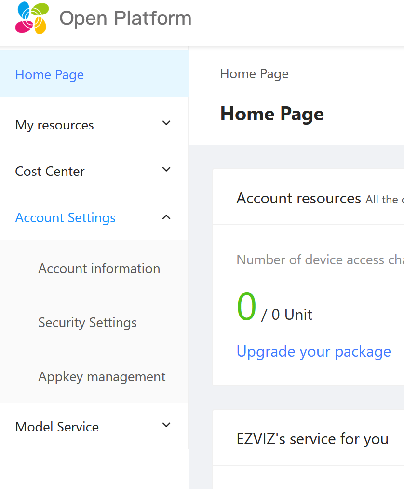

3. Click **Copy** next to **AppKey**.
4. For Liza web, you can also click **Copy** next to **Secret** (the AppSecret). Don't click **Reset**: it replaces the Secret and the old one stops working.

   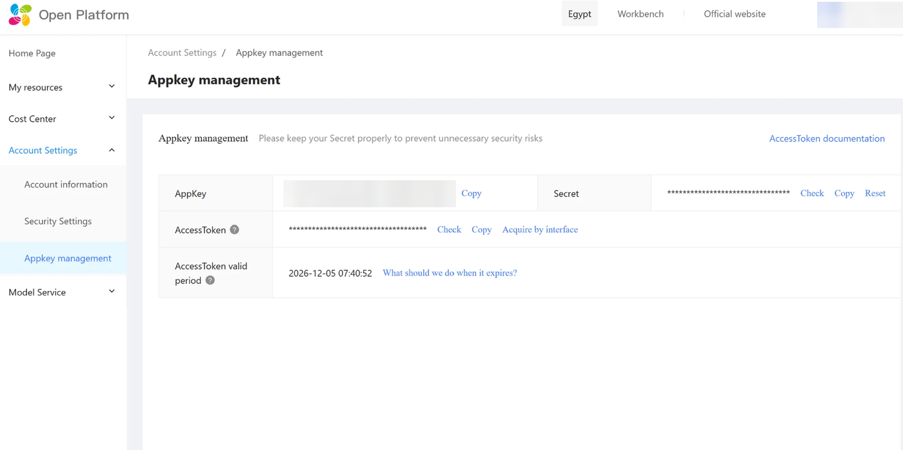

You don't need the **AccessToken** shown on the same page; Liza gets its own session. Keep the AppKey and Secret private. The AppKey value and account name are blurred in this screenshot.

## Install the APK

1. Download `Liza-0.5.0.apk` from the repository's **Releases** page.
2. Open it on your phone. Android will ask you to allow installs from your browser or file manager; allow it for that app only.
3. Tap **Install**.

From 0.4.0 the APK is a signed release build. Versions up to 0.3.0 were debug-signed: Android won't update those to a release build, so **uninstall the old Liza first**. You'll need to enter your AppKey and sign in again.

## Language

The first time you open Liza, it asks for your language: **English** or **العربية** (Arabic). In Arabic the whole app is right-to-left, except the video and its controls, which stay as they are. Dates keep Western digits so they match the camera's timestamps.

To change it later, open **About** (the **i** button) and tap the other language. Liza restarts in that language. Your sign-in and settings are kept.

## First-time setup

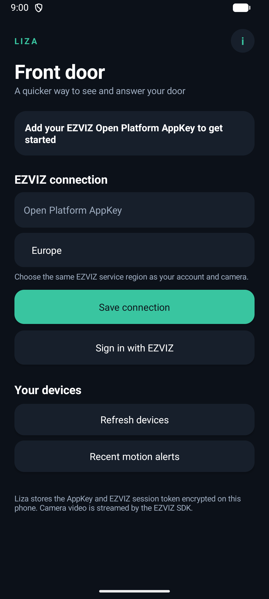

1. **Enter the AppKey.** Paste your Open Platform AppKey into the **Open Platform AppKey** field.
2. **Choose the region.** Pick the EZVIZ service region your account and camera belong to.

   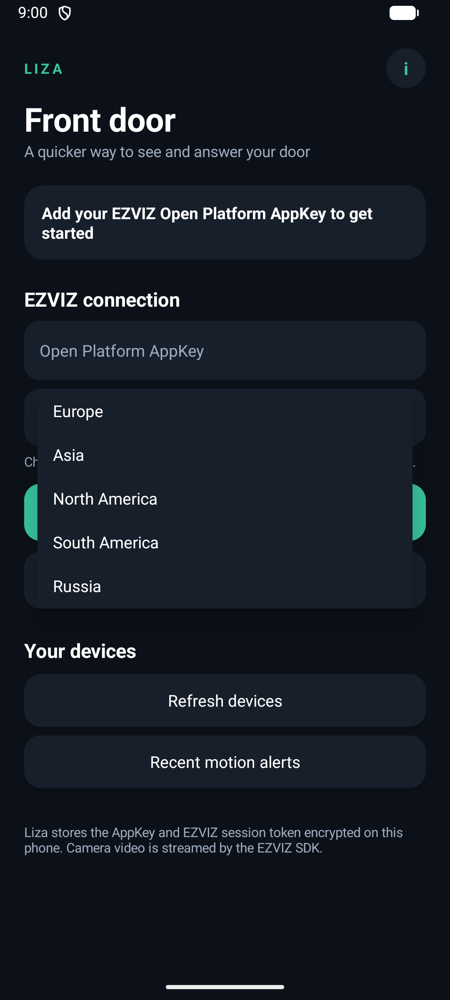

   | Region | API server |
   |---|---|
   | Europe (default) | `ieuopen.ezvizlife.com` |
   | Asia | `isgpopen.ezvizlife.com` |
   | North America | `iusopen.ezvizlife.com` |
   | South America | `isaopen.ezvizlife.com` |
   | Russia | `irusopen.ezvizru.com` |

   A wrong region is the most common cause of sign-in or device-list errors.
3. **Tap Save connection.** Liza encrypts the AppKey and region on the phone and starts the EZVIZ SDK. If the status card says *SDK setup failed*, check the AppKey and region.
4. **Tap Sign in with EZVIZ.** EZVIZ's own sign-in page opens inside the app. You sign in there; Liza never sees or stores your EZVIZ password. When EZVIZ returns, Liza stores the session token (encrypted) and loads your devices.

Changing the AppKey or the region later signs you out, because the old session token no longer applies.

## Home screen

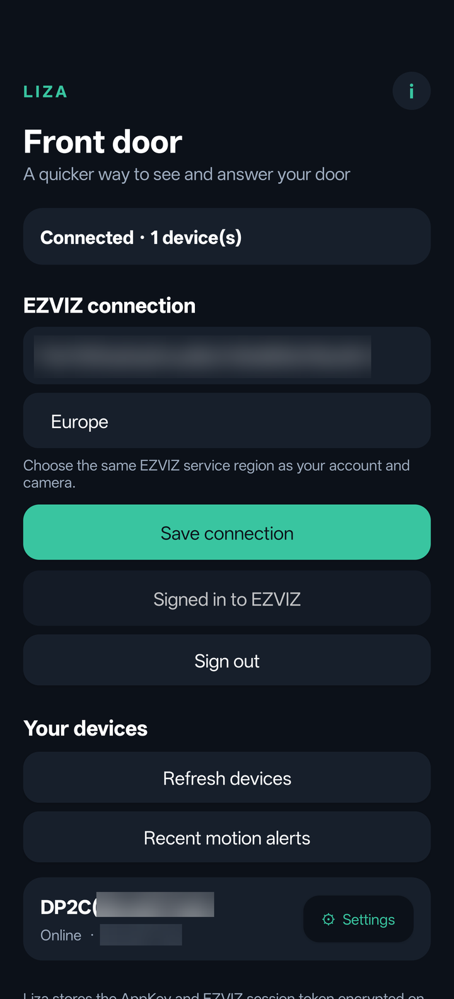

After sign-in the home screen shows:

| Element | What it does |
|---|---|
| **Status card** | Current connection state, such as *Connected · 1 device(s)* or an EZVIZ error code. |
| **Sign in with EZVIZ / Signed in to EZVIZ** | Opens EZVIZ sign-in. It is greyed out while you are signed in. |
| **Sign out** | Appears only when signed in. Logs out of the SDK and deletes the stored session token. |
| **Refresh devices** | Reloads your device list. Liza loads the first 20 devices on the account. |
| **Recent motion alerts** | Opens the [Motion alerts](#motion-alerts) screen. |
| **Device rows** | Each shows the device name, *Online/Offline* and the serial number. Tap the row for [Live view](#live-view), or **⚙ Settings** for [Device settings](#device-settings). |
| **i** (top right) | Opens the [About screen](#about-screen). |

## Live view

Tapping a device starts live video from its first camera channel.

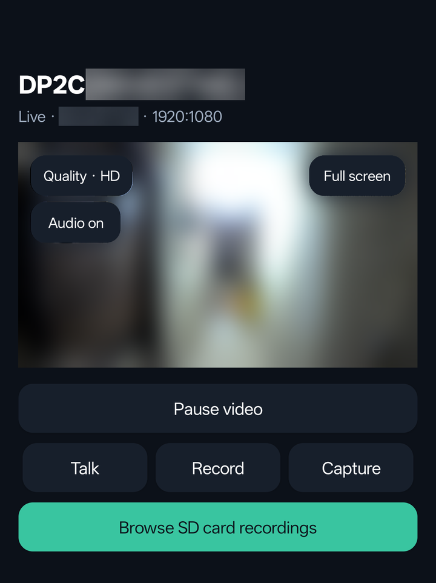
&nbsp;
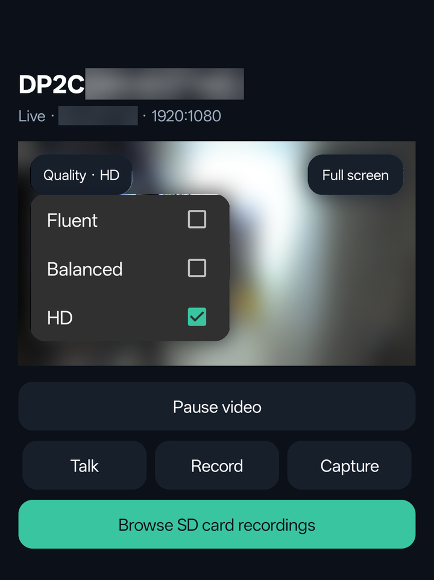

**On the video:**

| Control | What it does |
|---|---|
| **Quality · Fluent / Balanced / HD** | Asks the camera to change stream quality. The stream restarts. Your choice is remembered per camera. Not available during two-way talk or recording playback. |
| **Audio on / Audio off** | Mutes or unmutes the camera's sound on your phone. |
| **Full screen** | Switches to landscape full screen. Press **Back** or **Exit full screen** to return. |
| **Pinch** | Zooms the video up to 4×. Drag with two fingers to pan while zoomed. Pinching back below about 1.05× resets the zoom. |

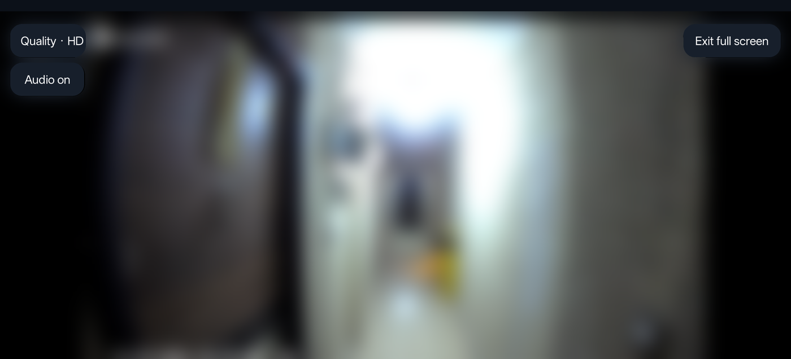

**Below the video:**

| Button | What it does |
|---|---|
| **Pause video / Resume video** | Stops or restarts the live stream. During recording playback it reads **Return to live view**. |
| **Talk / End talk** | Starts two-way audio. Android asks for microphone permission the first time. Live video keeps playing; the camera's speaker audio is muted on your phone while you talk to avoid echo. |
| **Record / Stop recording** | Records the live stream to an MP4 and saves it to **Movies/Liza**. |
| **Capture** | Saves a JPEG snapshot to **Pictures/Liza**. Not available during talk. |
| **Browse SD card recordings** | Opens the camera's SD card recordings (see below). |

**Encrypted video.** If the camera has video encryption on, Liza asks for the **6-character verification code** printed on the camera's label. It is saved (encrypted) per camera, so you only enter it once.

**Connection fallback.** Liza first connects through EZVIZ's relay servers. If the camera connects but no video frames arrive within 10 seconds, or the stream fails, Liza retries once with a direct peer-to-peer (P2P) connection.

## SD card recordings

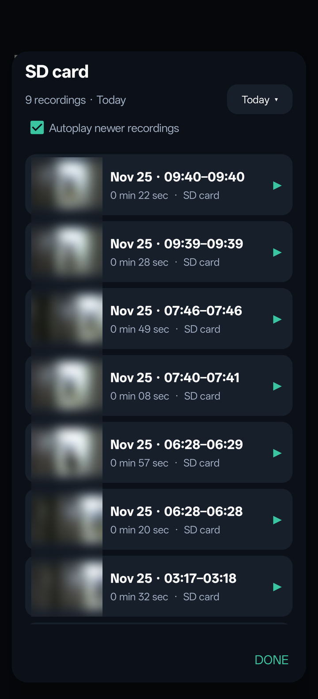
&nbsp;
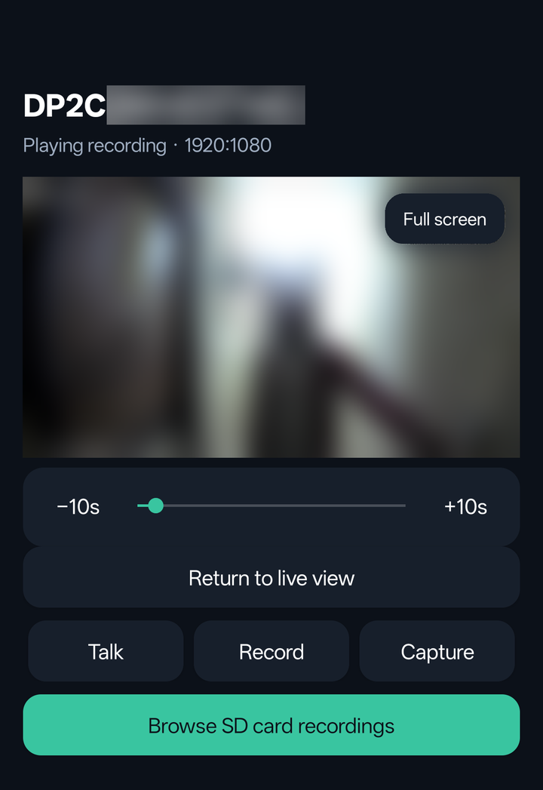

1. Tap **Browse SD card recordings**. Live view pauses while Liza asks the camera for today's recordings. If the camera doesn't answer within 30 seconds, the search is cancelled.
2. Recordings are listed newest first, with the time range and duration.
3. Liza builds preview thumbnails in the background by briefly playing each clip and grabbing a frame. Thumbnails are cached, so they load instantly next time.
4. Tap the date button (**Today ▾**) to choose another day.
5. Tap a recording to play it. A seek bar and **−10s / +10s** buttons appear under the video.
6. With **Autoplay newer recordings** ticked (the default), Liza plays the next newer clip when one ends.
7. Tap **Return to live view** to go back to live video.

Battery-powered cameras such as the DP2C may be asleep. If a search times out with error **120008**, wake the camera with live view or the doorbell button, then retry.

## Motion alerts

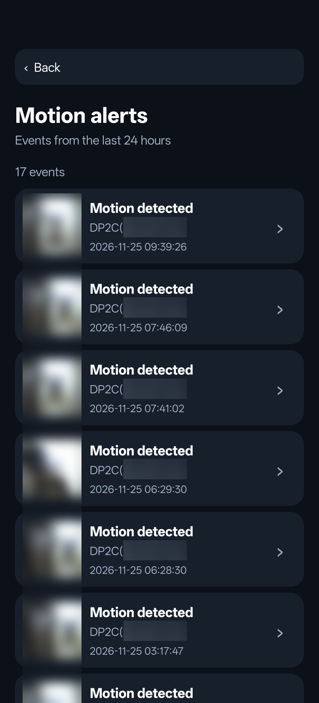
&nbsp;
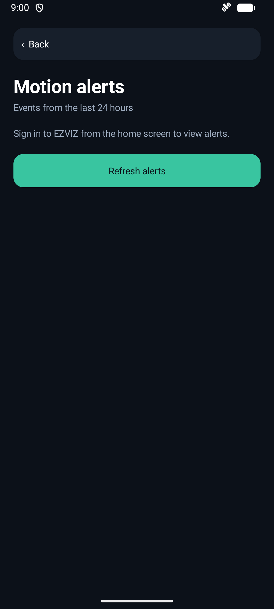

The **Motion alerts** screen lists up to 50 events from the last 24 hours across all your devices. Each card shows the event type, the device, the time and, when EZVIZ provides one, a snapshot.

Tap an alert to open live view for that camera. Liza then searches the SD card for the recording closest to the alert time and plays it, starting at the moment of the event.

Liza does **not** send push notifications for alerts. Open this screen to check events. See [Known issues](KNOWN_ISSUES.md#no-push-notifications).

## Device settings

Open with **⚙ Settings** on a device row.

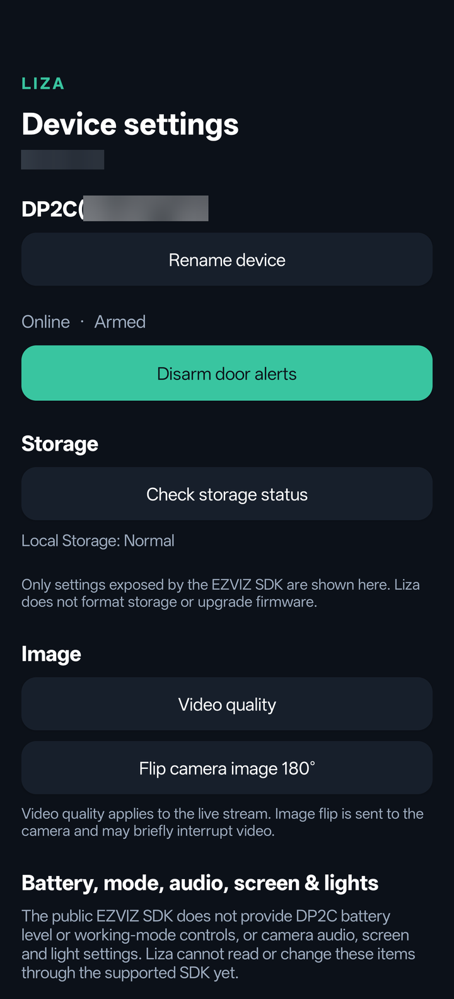

| Setting | What it does |
|---|---|
| **Rename device** | Changes the device name on your EZVIZ account. |
| **Arm / Disarm door alerts** | Turns the camera's motion detection ("defence") on or off. Disabled if the device doesn't support it. The line above shows *Online/Offline · Armed/Disarmed*. |
| **Check storage status** | Reports each storage medium as *Normal*, *Wrong storage medium*, *Unformatted* or *Formatting*. Liza never formats storage. |
| **Video quality** | Sets the live stream quality on the camera (Fluent, Balanced or HD). |
| **Flip camera image 180°** | Sends an image-flip command. Video may stutter briefly. |

### SD card reminder

EZVIZ reports the SD card's size but not its free space, and the space a camera uses isn't proportional to how long its clips are. So Liza uses something it can observe instead: **when a card is full, the camera overwrites its oldest recordings.**

| Control | What it does |
|---|---|
| **Card emptied on** | The day you emptied or formatted the card. |
| **A full card lasts about … days** | Optional. If you know from experience (for example 90), Liza plans from it. |
| **Check the card** | Reads the card size, the last 7 days of recordings, and the oldest recording on the card. If the oldest recording is newer than the day you emptied the card, the card is full and overwriting. Liza then knows how many days a full card holds, saves it, and uses it from then on. Otherwise it suggests a check date: a little before the card should fill, or after 30 days if it doesn't know yet. |
| **Find oldest recording** | Finds the oldest recording on the card and sets it as the emptied date, if you don't remember it. |
| **Remind me on** / **Save reminder** | Liza shows a notification at about 9:00 on that day. On Android 13 and newer it asks for notification permission. |
| **Add to calendar** | Opens your calendar app with the reminder filled in. |
| **I emptied the card today** | Starts a new period. If the card was full, Liza uses the time since it was last emptied as the card's lifespan. |

Checking the card wakes the camera and reads its SD card a day at a time, so it takes 10–30 seconds.

Battery level, working mode, chime and speaker volume, screen and light settings are **not** available. The public EZVIZ SDK does not expose them for the DP2C; use the official EZVIZ app for those.

## About screen

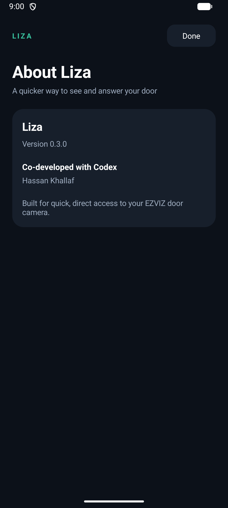

Shows the installed version, credits and the **Language** choice (English or العربية). Tap **Done** to return.

## Where your photos and videos go

| Item | Location |
|---|---|
| Snapshots | `Pictures/Liza/Liza-<timestamp>.jpg`, visible in your gallery |
| Recordings | `Movies/Liza/Liza-<timestamp>.mp4`, visible in your gallery |
| SD card thumbnails | App cache (`record-thumbnails/`); deleted when you clear the app cache |

On Android 9 and older, Liza asks for storage permission the first time you save a photo or video. On Android 10 and newer no permission is needed.

## Troubleshooting

| Message or symptom | What to try |
|---|---|
| *SDK setup failed. Check the AppKey and selected region.* | Check the AppKey for typos and stray spaces, and confirm the region. |
| *Could not load devices (EZVIZ error …)* | Usually a wrong region or an expired session. Sign out, check the region, and sign in again. |
| *Connected. No devices were returned for this account.* | Add the camera to this EZVIZ account in the official app, then tap **Refresh devices**. |
| *Video error 400035 / 400036* or a code prompt | The stream is encrypted. Enter the verification code from the camera label. |
| *The camera connected but sent no video frames.* | Liza retries over P2P automatically. If it still fails, wake the camera and tap **Resume video**. |
| SD search error **120008** | The camera is asleep or offline. Wake it and retry. |
| SD search error **110001** | Check the camera's date and time in the EZVIZ app, then try another date. |
| *Microphone permission is needed for two-way audio.* | Grant the microphone permission in Android Settings → Apps → Liza → Permissions. |
