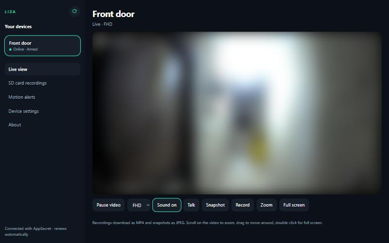
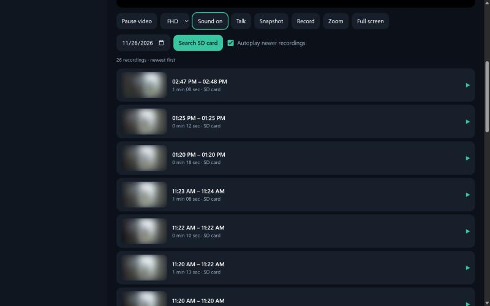
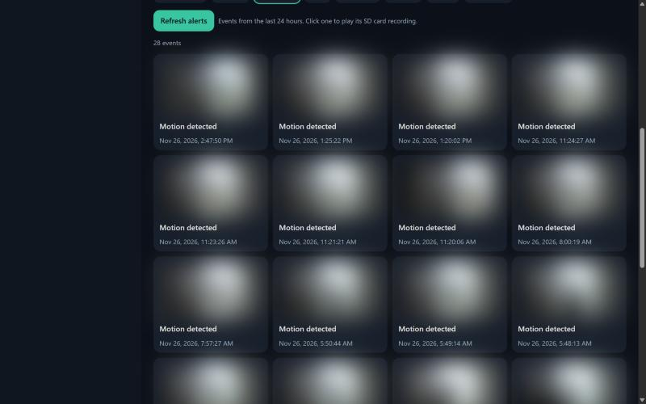
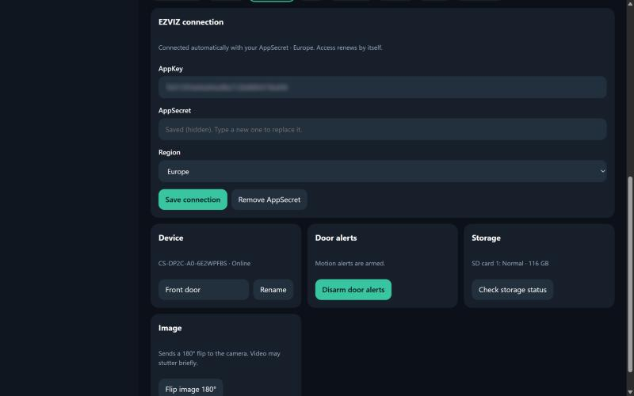
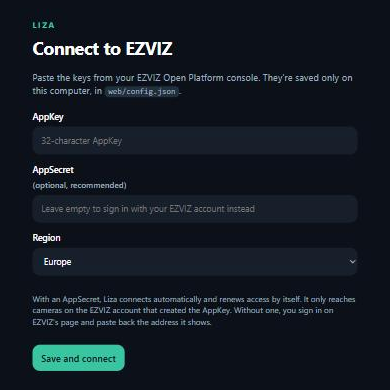

# Liza web

> **العربية:** خطوات الإعداد بالعربية في [README.ar.md](../README.ar.md#الإعداد-على-الكمبيوتر-ليزا-ويب).

The computer version of Liza: a fast, private web app for your EZVIZ camera. It runs entirely on your own computer at `http://localhost:8790`. A small Python server keeps your EZVIZ access on that computer, and the page plays video with EZVIZ's official web player (EZUIKit).

<p align="center">
  
</p>

> Camera video, thumbnails, keys and serial numbers in these screenshots are blurred for privacy.

## Features

- **Live video** with SD / HD / FHD quality (whatever your camera reports), sound on/off, and two-way talk
- **Zoom** up to 4× with the scroll wheel or on-video buttons, drag to move around, and **full screen** (double-click, button or **F**)
- **Snapshots** (JPEG) and **recordings** (MP4) downloaded by your browser
- **SD card recordings** by date, with thumbnails, ±10 s, and autoplay of newer clips
- **Motion alerts** from the last 24 hours with snapshots; click one to play its recording
- **Device settings**: rename, arm/disarm, SD card status, 180° image flip
- **English and Arabic** (العربية): a language window on first run, a right-to-left layout in Arabic, and a switch in **About** and on the setup screens
- **SD card reminder**: detects when the card is full and overwriting, learns how many days a full card lasts, and reminds you before the next one fills (in Liza and as a calendar file)
- **Stall guard**: if live video stops advancing for 6 seconds, Liza saves any recording in progress and reconnects

| Recordings | Alerts | Settings |
|---|---|---|
|  |  |  |

## Requirements

- Python 3.10 or newer. No extra packages needed.
- A desktop browser: Chrome, Edge or Firefox.
- An EZVIZ account and an **EZVIZ Open Platform AppKey**, created in the Open Platform console for the same region as your account. An **AppSecret** from the same page is optional but recommended.

## Quick start

Download **Liza-web-1.2.0.zip** from the [Liza web release](https://github.com/titaniumgui/Liza/releases/tag/web-v1.2.0) and unzip it, or clone this repository.

**Windows:** double-click **`Start Liza.bat`** in the `web` folder.

**Any system:**

```bash
cd web
python get_player.py   # one time: downloads EZVIZ's web player (about 19 MB) into web/vendor
python server.py       # then open http://localhost:8790
```

`get_player.py` downloads `ezuikit-js` 9.0.26 from npm and checks it against a pinned SHA-512 checksum before installing it.

## First run

Liza first asks for your language (English or العربية). You can change it later in **About**, or with the language link on the setup and sign-in screens. The choice is stored in this browser.

Then it opens **Connect to EZVIZ**:



1. Paste your **AppKey**.
2. Optionally paste your **AppSecret**.
3. Choose the **region** your EZVIZ account belongs to.

Liza checks an AppKey/AppSecret pair with EZVIZ before saving it. You can change all three later in **Device settings → EZVIZ connection**.

### AppSecret or sign-in?

| | With AppSecret | Without (EZVIZ sign-in) |
|---|---|---|
| Connecting | Automatic | Sign in on EZVIZ's page, then paste back the address it shows |
| Renewal | Automatic | Sign in again about once a week |
| Cameras | Only those on the account that **created the AppKey** | Any account you sign in with |

**About the sign-in step.** EZVIZ only returns you to its own success page, so Liza can't receive the session automatically. After you sign in, copy the address of EZVIZ's success page (it contains `access_token=`) and paste it into Liza. Liza never sees your EZVIZ password.

## Privacy and security

- Everything runs on your computer. The server listens on `127.0.0.1` only, and refuses requests from other websites (by `Origin`) or other host names (by `Host`).
- `config.json` (AppKey, AppSecret) and `session.json` (access token) stay on your computer and are excluded from git. The page never receives the saved AppSecret back.
- The server forwards only a fixed list of EZVIZ API calls.
- No analytics. The only outside services are EZVIZ's servers and, once, npm for the player download.

## Files

| Path | What it is |
|---|---|
| `server.py` | Local server: setup, session, a fixed list of EZVIZ API calls, static files |
| `get_player.py` | Downloads and verifies EZVIZ's web player into `vendor/` |
| `public/` | The app: `index.html`, `app.js`, `app.css`, `i18n.js` (translation layer) |
| `public/i18n/ar.json` | Arabic translations, keyed by the English text |
| `config.example.json` | Template for `config.json` (created by the setup screen) |
| `Start Liza.bat` | Windows launcher |

## Notes and workarounds

- **Region matters.** AppKeys are registered per region. For example, a Europe AppKey is unknown to EZVIZ's global server and returns error 10017.
- **Times.** EZVIZ's web API reports SD card and alert times as the camera's local clock written as if it were UTC. Liza corrects for this using your computer's time zone, which is assumed to match the camera's.
- **SD playback outside UTC.** EZVIZ's player looks up a whole calendar day of clips, which EZVIZ's server rejects when that day spans two UTC dates (playback error 5402/395402). `app.js` narrows that lookup to the clip being played.
- **Thumbnails.** EZVIZ gives no cover image for SD clips. Liza uses the matching motion-alert snapshot, or briefly plays the clip in a hidden player to grab a frame, and caches the result in your browser.
- **SD card reminder.** EZVIZ reports the card's size but not its free space, and recordings have no file size. Clip length × bitrate was about 10× too optimistic on a DP2C: it predicted about 950 days for a 128 GB card that filled in about 90. So Liza checks whether the oldest recording on the card is newer than the day you emptied it. If so, the card is full and overwriting, and the span from that recording to today is how many days a full card holds. Reminders are kept in this browser's storage. Use **Add to calendar** to be reminded when Liza isn't open.
- **Battery cameras.** Live video and thumbnail grabs wake the camera. Liza stops the stream a minute after you switch to another tab.
- Tested with an EZVIZ DP2C on the Europe region.
